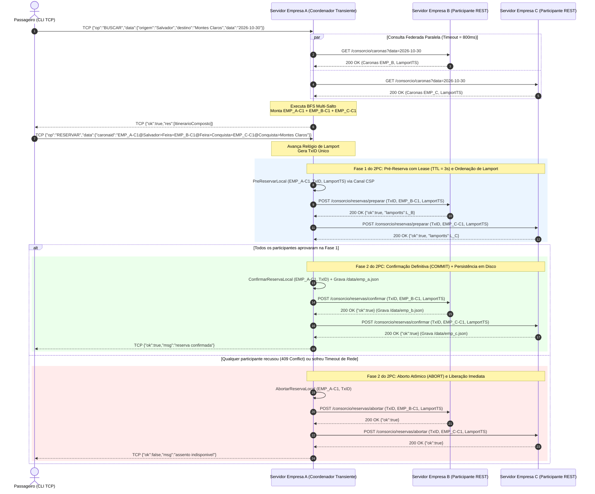

# Especificação da API REST do Consórcio Vumbora (VaiJunto)

## 1. Visão Geral
Os servidores das empresas integrantes do consórcio comunicam-se exclusivamente via protocolo HTTP/1.1 sob arquitetura REST com payloads codificados em JSON (`Content-Type: application/json`). Não existe servidor central, coordenador fixo nem armazenamento compartilhado entre as instâncias.

Para ordenação total e sincronização causal de eventos sem dependência de relógios físicos (NTP), todas as requisições e respostas trafegam o contador lógico de Lamport no campo `lamportts`. Ao receber uma mensagem com estampa remota `L_remoto`, a goroutine monitora do servidor receptor atualiza seu relógio local segundo a regra de Lamport:

`L_local = max(L_local, L_remoto) + 1`

---

## 2. Recursos e Endpoints do Consórcio

### 2.1. Consulta de Caronas Disponíveis na Empresa Parceira
Retorna as caronas ativas gerenciadas localmente pela empresa consultada para composição de itinerários federados no grafo de busca em largura (BFS). As pré-reservas temporárias ativas já são contabilizadas no campo `assentosocupados` exportado.

* **Método e Caminho:** `GET /consorcio/caronas`
* **Parâmetros de Query (Opcionais):**
  * `data`: Filtra as caronas ativas pela data de partida no formato `YYYY-MM-DD` (ex.: `2026-10-30`).
  * `lamportts`: Estampa lógica atual do servidor solicitante (inteiro sem sinal de 64 bits).
* **Códigos de Retorno:**
  * `200 OK`: Lista de caronas ativas retornada com sucesso.
  * `405 Method Not Allowed`: Método HTTP diferente de `GET`.
* **Exemplo de Resposta (`200 OK`):**

```json
{
  "empresaid": "EMP_B",
  "lamportts": 14,
  "caronas": [
    {
      "empresaid": "EMP_B",
      "motoristaid": "mot_b@vaijunto.com",
      "id": "EMP_B-C1",
      "datapartida": "2026-10-30T00:00:00Z",
      "assentosdisponiveis": 2,
      "valorportrecho": 60.0,
      "trechos": [
        {
          "cidadeorigem": "Feira",
          "cidadedestino": "Conquista",
          "assentosocupados": 1,
          "passageiros": ["pass1@email.com"],
          "cancelado": false
        }
      ],
      "veiculo": {
        "placa": "",
        "modelo": "",
        "capacidadetotal": 0
      },
      "ativa": true
    }
  ]
}
```

---

### 2.2. Fase 1 do 2PC: Pré-Reserva de Trecho (`PREPARE`)
Solicita o bloqueio temporário (*lease* com tempo de vida `TTL = 3s`) de um assento em todos os subtrechos compreendidos entre `origem` e `destino` de uma carona específica.

* **Método e Caminho:** `POST /consorcio/reservas/preparar`
* **Critério de Precedência e Preempção (Requisito 3):**
  1. Se houver assento livre (`assentosocupados + len(prereservas) < assentosdisponiveis`), registra a pré-reserva com expiração em 3 segundos.
  2. Se a capacidade estiver esgotada por reservas definitivas (`assentosocupados >= assentosdisponiveis`), rejeita imediatamente com `409 Conflict`.
  3. Se o último assento estiver retido apenas por uma pré-reserva ainda não confirmada (`T_atual`), compara-se a tupla `(lamportts, empresacoord, txid)` da requisição recebida com a de `T_atual`. Se a nova transação tiver menor valor de `lamportts` (ou, em caso de empate, menor `empresacoord` lexicográfico), ela preempta `T_atual` e assume a pré-reserva.
* **Corpo da Requisição:**

```json
{
  "txid": "TX-EMP_A-15-1729380000",
  "caronaid": "EMP_B-C1",
  "origem": "Feira",
  "destino": "Conquista",
  "passageiroid": "caike@uefs.br",
  "empresacoord": "EMP_A",
  "lamportts": 15
}
```

* **Códigos de Retorno:**
  * `200 OK`: Pré-reserva concedida e bloqueada temporariamente por 3 segundos.
  * `400 Bad Request`: Payload JSON malformado.
  * `405 Method Not Allowed`: Método HTTP diferente de `POST`.
  * `409 Conflict`: Assento indisponível ou bloqueado por transação concorrente de maior precedência lógica.
* **Corpo da Resposta (`200 OK` ou `409 Conflict`):**

```json
{
  "ok": true,
  "msg": "pre-reserva registrada",
  "empresaid": "EMP_B",
  "lamportts": 16
}
```

---

### 2.3. Fase 2 do 2PC: Confirmação Definitiva (`COMMIT`)
Converte uma pré-reserva ativa (identificada por `txid`) em reserva definitiva, incrementando `assentosocupados`, anexando `passageiroid` à lista de passageiros dos subtrechos e persistindo atomicamente o estado em disco (`DATA_FILE`).

* **Método e Caminho:** `POST /consorcio/reservas/confirmar`
* **Corpo da Requisição:**

```json
{
  "txid": "TX-EMP_A-15-1729380000",
  "caronaid": "EMP_B-C1",
  "origem": "Feira",
  "destino": "Conquista",
  "passageiroid": "caike@uefs.br",
  "empresacoord": "EMP_A",
  "lamportts": 18
}
```

* **Códigos de Retorno:**
  * `200 OK`: Reserva confirmada definitivamente e sincronizada em disco.
  * `400 Bad Request`: Payload JSON malformado.
  * `405 Method Not Allowed`: Método HTTP diferente de `POST`.
  * `409 Conflict`: Pré-reserva expirada por TTL ou preemptada por outra transação antes do recebimento do `COMMIT`.
* **Corpo da Resposta (`200 OK`):**

```json
{
  "ok": true,
  "msg": "reserva confirmada",
  "empresaid": "EMP_B",
  "lamportts": 19
}
```

---

### 2.4. Fase 2 do 2PC: Aborto e Rollback Transacional (`ABORT`)
Remove imediatamente a pré-reserva associada ao `txid` (ou reverte a reserva definitiva caso acionado como compensação por falha parcial de outro nó na Fase 2), liberando o assento e atualizando o arquivo de persistência se necessário. Operação idempotente.

* **Método e Caminho:** `POST /consorcio/reservas/abortar`
* **Corpo da Requisição:**

```json
{
  "txid": "TX-EMP_A-15-1729380000",
  "caronaid": "EMP_B-C1",
  "origem": "Feira",
  "destino": "Conquista",
  "passageiroid": "caike@uefs.br",
  "empresacoord": "EMP_A",
  "lamportts": 20
}
```

* **Códigos de Retorno:**
  * `200 OK`: Transação abortada e assento liberado com sucesso.
  * `400 Bad Request`: Payload JSON malformado.
  * `405 Method Not Allowed`: Método HTTP diferente de `POST`.
* **Corpo da Resposta (`200 OK`):**

```json
{
  "ok": true,
  "msg": "transacao abortada e assento liberado",
  "empresaid": "EMP_B",
  "lamportts": 21
}
```

---

### 2.5. Cancelamento Posterior de Reserva Federada (`CANCEL`)
Permite que um passageiro conectado ao servidor da sua própria empresa cancele posteriormente uma reserva já confirmada em carona pertencente a outra empresa do consórcio.

* **Método e Caminho:** `POST /consorcio/reservas/cancelar`
* **Corpo da Requisição:**

```json
{
  "txid": "CANCEL-caike@uefs.br",
  "caronaid": "EMP_B-C1",
  "origem": "Feira",
  "destino": "Conquista",
  "passageiroid": "caike@uefs.br",
  "empresacoord": "EMP_A",
  "lamportts": 25
}
```

* **Códigos de Retorno:**
  * `200 OK`: Reserva localizada, removida e assento devolvido ao estoque com atualização em disco.
  * `400 Bad Request`: Payload JSON malformado.
  * `409 Conflict`: Reserva não encontrada para o passageiro informado nos trechos especificados.
* **Corpo da Resposta (`200 OK`):**

```json
{
  "ok": true,
  "msg": "",
  "empresaid": "EMP_B",
  "lamportts": 26
}
```

---

## 3. Tabela Resumo de Recursos e Códigos HTTP

| Recurso (Endpoint) | Método | Papel no Protocolo | Sucesso | Erro de Concorrência / Negócio | Erro de Requisição |
| :--- | :---: | :--- | :---: | :---: | :---: |
| `/consorcio/caronas` | `GET` | Descoberta de Grafo Federado | `200 OK` | - | `405 Method Not Allowed` |
| `/consorcio/reservas/preparar` | `POST` | 2PC Fase 1 (*Prepare* + *Lease* 3s + Lamport) | `200 OK` | `409 Conflict` | `400 Bad Request` |
| `/consorcio/reservas/confirmar` | `POST` | 2PC Fase 2 (*Commit* + Persistência) | `200 OK` | `409 Conflict` | `400 Bad Request` |
| `/consorcio/reservas/abortar` | `POST` | 2PC Fase 2 (*Rollback* / Compensação) | `200 OK` | - | `400 Bad Request` |
| `/consorcio/reservas/cancelar` | `POST` | Cancelamento de Viagem pelo Usuário | `200 OK` | `409 Conflict` | `400 Bad Request` |

---

## 4. Diagrama de Sequência da Confirmação de Itinerário Multi-Empresa

O diagrama abaixo detalha o fluxo completo de busca federada e confirmação atômica via protocolo *Two-Phase Commit* (2PC) de um itinerário composto por trechos em três empresas distintas (`EMP_A`, `EMP_B` e `EMP_C`):

